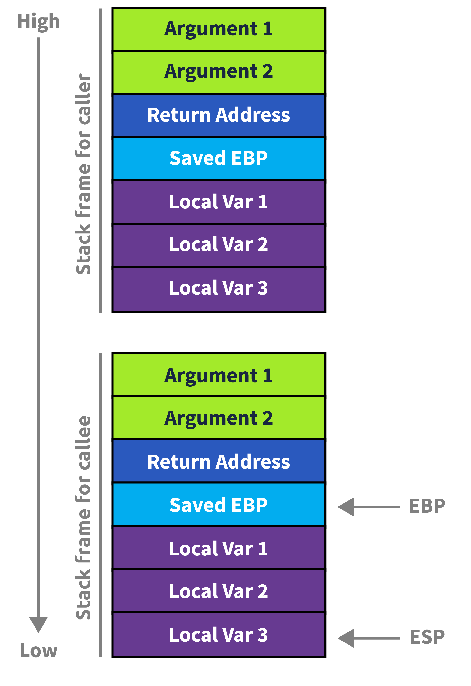

# execstack
`execstack` demonstrates a basic ret2shellcode-style exploit. 

ret2shellcode exploits the way return addresses are stored on the stack. 
By overwriting them with an address we control, we can redirect program flow towards our shellcode.

## Set-up
```
sudo bash -c 'echo 0 > /proc/sys/kernel/randomize_va_space'
```
This removes ASLR. This kind of exploit isn't impossible with ASLR on, but it certainly makes it easier!

To undo it, use the command
```
sudo bash -c 'echo 1 > /proc/sys/kernel/randomize_va_space'
```


## Compilation
```
gcc -fno-stack-protector -no-pie -z execstack -w -g -O0 -o execstack execstack.c
```

Flags of note:
- `-fno-stack-protector` removes the canary
- `-no-pie` removes PIE (which, alongside ASLR, removes address randomization)
- `-z execstack` removes the NX bit

## Running the attack
```
python3 excstk.py
```

Note: you will need [pwntools](https://docs.pwntools.com/en/stable/install.html) installed in your environment.

If the attack doesn't work on your machine, it might be due to the hard-baked address in `excstk.py`.


## Write-up
There are a lot of ways to exploit this binary. For this attack specifically, we'll be focusing on the vulnerability in line 47:
```
    fgets(inp, 300, stdin);
```
Note that `inp` is an array with 30 bytes, so this `fgets` allows us a buffer overflow.

Using our buffer overflow, we want to override the return address saved on the call stack.
[](https://tryhackme.com/room/x8664arch)
Specifically, our `inp` buffer is stored before the `main` function return pointer, since it's a local variable in `main`.
So we want main to return to some address we control.

From set-up and compilation, we know that the binary has no ASLR, PIE, NX, or canary.
This means we can store our shellcode on the stack (specifically, in th `inp` buffer) and have our program jump to the address of the shellcode.
This might beg the question: how do we know what addresses to jump to? And how do we know the offset from our `inp` to the ret address?

I use the tool [pwndbg](https://pwndbg.re/stable/) in conjunction with pwntools to help determine it.
pwndbg is basically a juiced up version of gdb, specialized for binary exploitation.

First, use pwn's `cyclic` function to send in a regular cycle of characters. These cycles look something like AAABAAACAAAD... 
Send in the cycle when the program asks for input. Note that the cycle should be large, and that this will crash the program.
If we use pwndbg to step through the program before it crashes, we can print out things like return addresses and examine the values stores in those addresses.
We copy in the hex stored at those addresses and use pwn's `cyclic_find` to determine the offset. 
The cycle has a regular pattern to it, so `cyclic_find` helps us figure out where return address is on the stack without us needing to do too much math.

Next, to craft our shellcode, we use pwn's handy `shellcraft.sh()` function. 
We convert it to assembly using `asm(shellcraft.sh())`. Finally, we decide to fill the inside of the buffer with nonsense and jump to some area past the end of the function.
We'll use eight bytes above the return address `0x7fffffffe4c8`, to account for the size of the return address.

The next part is a little tricky. Due to how the binary's set up, if we want to return from main, we have to clear the `system(job.cmd);` on line 62. (This is also why our payload starts with the char `d`.)
`system` executes whatever system command string is passed in as an argument. 
In our payload, we have to make sure we don't change the string store in `job.cmd` (or we change it to a valid system call), or else our binary will crash. 
We can do this using our `cyclic_find()` trick, plus some offset math. 
However, since we're doing a function call, we also have to ensure that our payload is 16-byte stack aligned, or else the function will crash. 
The `asm(shellcraft.sh())` returns something that is a factor of 16, but to byte-align our payload, we need something that is a factor of 16x+8.

That's where a nop-sled comes in handy. `nop`s are essentially 1-byte "no-operations". 
A nop-sled is a long string of `nop`s that end in some sort of shellcode (or other code we want to execute). 
They're generally used as padding, especially if we don't know the exact memory address of our shellcode, e.g. if NX is off but we have ASLR. 
Here, we're going to use it to pad out our stack so the system call doesn't crash. (I use a nop sled of length 72, which is a little excessive, but it gets the job done.)

The final payload:
```
payload = b"d" * cmd_offset + p64(bin_echo) + b"A" * ret_offset + p64(nop_addr) + nop_slide + shellcode
```


# ropper
`ropper` demonstrates a basic ret2libc-style exploit.

ret2libc exploits the way instructions like `pop` and `ret` interact with the stack, alongside the fact that pretty much every C binary is linked to libc in some way.
By overwriting registers with specific values or instruction addresses, we can redirect program flow towards `system("/bin/sh")`.


## Set-up
The same as with `execstack`. Run the following to remove ASLR:
```
sudo bash -c 'echo 0 > /proc/sys/kernel/randomize_va_space'
```

To undo it, use the command
```
sudo bash -c 'echo 1 > /proc/sys/kernel/randomize_va_space'
```


## Compilation
```
gcc -fno-stack-protector -no-pie -w -g -O0 -o ropper ropper.c
```

See `execstack` for an explanation of the flags. Note the removal of `-z execstack`, since we now want the NX bit on.

## Running the attack
```
python3 rppr.py
```

Same caveats from `execstack` apply here. Make sure pwntools is installed.

## Write-up
With NX on, we're now going to use return-oriented programming (ROP) to exploit this binary. 
We follow a very similar path to `execstack`. We'll still be focusing the `fgets`, and we still use `cyclic` to find our offsets.

However, since we can't execute the stack anymore, we're going to find the code we want in the binary itself. 
ROP takes advantage of short snippets of assembly code in the binary, usually instructions preceding something like a `ret` or a `call`.
Think instructions like `pop rdi; ret`. These are called gadgets. 
The reason why instructions like `pop` are useful is because they take the next 8 (or 4, depending on the machine) bytes off the stack and store them in the specified register. 
So if I have a stack that has a pointer to a string like "/bin/sh" stored in it, `pop rdi` stores that value in `rdi`. 
Then we return. Return also looks at the next value on the stack and jumps to it. 
Let's say I have `/bin/sh` loaded in `rdi`, and then I jump to the instruction `system`, which is conveniently loaded in libc, a library pretty much every C binary has by default... 
That gives us shell!

That's the core idea of ret2libc. Instead of introducing new code, we manipulate program flow to specific snippets of code stored in libc. 
(Note that ROP can also be used without libc, but this exploit requires libc, since the binary itself doesn't have enough gadgets to be useful.) 

To find gadgets, I use the tool [ropper](https://github.com/sashs/Ropper). 
Using a command like
```
ropper -f <program> --nocolor | grep "<keyword>"
```
we can find specific gadgets. For example,
```
ropper -f /usr/lib/x86_64-linux-gnu/libc.so.6 --nocolor | grep "call rax"
```
Will find all the gadgets that have `call rax`.

For this binary, I followed the logic I outlined above. We want to call `system("/bin/sh")`. 
Recall that in x86, the first argument is stored in `rdi`. Using ropper, we can find a `pop rdi; ret` gadget.
To get a pointer to the string "/bin/sh", we can use the function `next(libc.search(b"/bin/sh"))`, where `libc` is an ELF object with libc loaded inside of it. 
Note that to do this, we need the base address for libc. Since we have ASLR turned off, we can use `ldd ropper` to get it, or go into pwndbg and use `vmmap` to get the full program layout, including libc. 
Finally, we us `libc.symbols["system"]` to get the pointer to the function `system`. Note that this works for any libc function.

One final nuance to consider: stack alignment! Since we `ret` to the `system` function, we need to ensure that by the time the function is called, the stack is properly 16-byte aligned. 
That's where the extra `ret` instruction comes into play. `ret` is conveniently 8 bytes, so we can use it to add 8 bytes to the stack to ensure it is properly aligned.

The final payload:
```
payload = b"d" * cmd_offset + p64(bin_echo) + b"A" * ret_offset + p64(ret_gadget) + p64(rdi_gadget) + p64(binsh) + p64(libc.symbols["system"])
```


